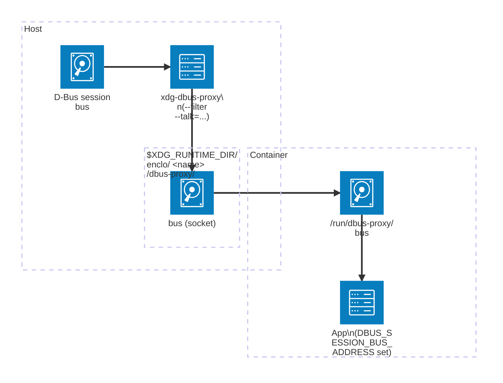
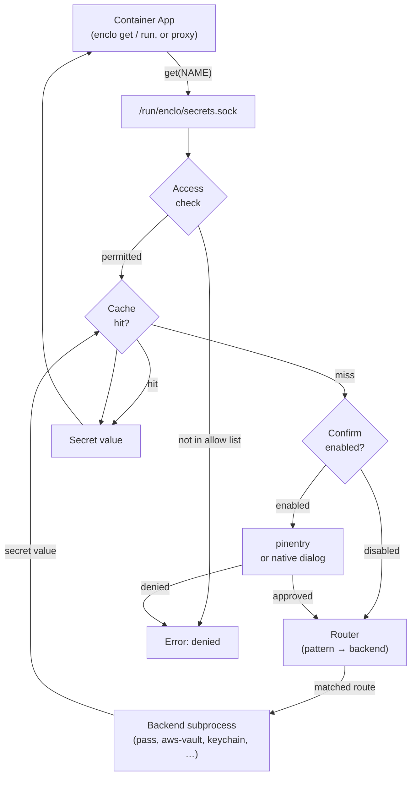
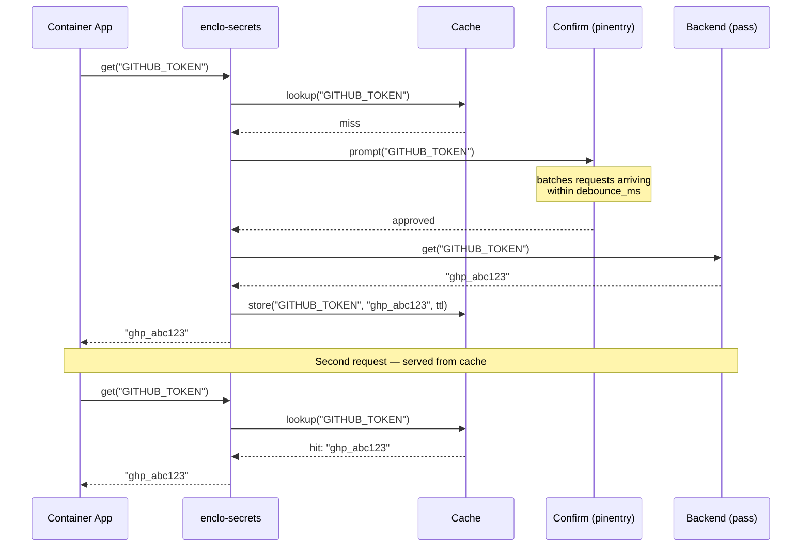
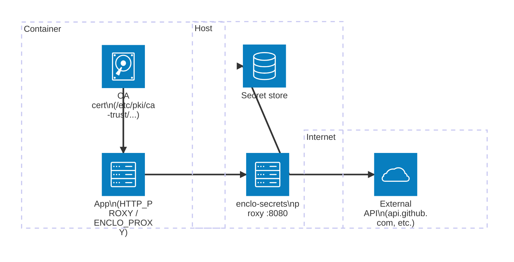

# Architecture

## System overview

`enclo` is an orchestrator that sets up security modules before starting a Podman container. Each module runs its setup phase, contributes environment variables, volume mounts, and podman arguments to a shared `ModuleOutput`, and the orchestrator assembles them into a final `podman run` invocation.

Modules that spawn sidecar processes (secrets service, D-Bus proxy) run alongside the container and are torn down when the container exits.

```mermaid
architecture-beta
    group host["Host"]
    group container["Container"]

    service enclo(server)["enclo"] in host
    service modules(gear)["Modules"] in host
    service podman(server)["podman"] in host
    service sidecars(server)["Sidecars\n(enclo-secrets,\nxdg-dbus-proxy)"] in host

    service pid1(server)["PID 1"] in container
    service app(server)["App / Shell"] in container

    enclo:R --> L:modules
    modules:B --> T:sidecars
    enclo:R --> L:podman
    podman:R --> L:pid1
    pid1:B --> T:app
    sidecars:R --> L:app
```



---

## SSH agent forwarding

The `ssh_agent` module resolves the host SSH agent socket (either the GPG agent's SSH socket or a standalone `ssh-agent`) and bind-mounts it into the container. No sidecar process is involved.

```mermaid
architecture-beta
    group host["Host"]
    group container["Container"]
    group gnupg["$XDG_RUNTIME_DIR/gnupg/"] in host

    service gpg_agent(server)["gpg-agent"] in host
    service ssh_socket(disk)["S.gpg-agent.ssh"] in gnupg
    service enclo(gear)["enclo\n(module setup)"] in host

    service mount(disk)["/run/ssh-agent.sock"] in container
    service app(server)["App\n(SSH_AUTH_SOCK set)"] in container

    gpg_agent:B --> T:ssh_socket
    enclo:R --> L:ssh_socket
    ssh_socket:R --> L:mount
    mount:B --> T:app
```



The container-side socket path is always `/run/ssh-agent.sock`. `$SSH_AUTH_SOCK` is set accordingly.

For the `standalone` backend, the socket at `$SSH_AUTH_SOCK` on the host is used instead of the GPG agent's socket.

---

## GPG agent forwarding

The `gpg_agent` module prepares a fresh `GNUPGHOME` directory with `no-autostart` configured (prevents the container from spawning its own agent), imports the host's public keys, and mounts the host agent's **extra socket** as the container's `S.gpg-agent`.

```mermaid
architecture-beta
    group host["Host"]
    group gnupg_host["$XDG_RUNTIME_DIR/gnupg/"] in host
    group runtime["$XDG_RUNTIME_DIR/enclo/<name>/gpg-agent/"] in host
    group container["Container"]
    group gnupg_container["$HOME/.gnupg/"] in container

    service gpg_agent(server)["gpg-agent"] in host
    service extra_sock(disk)["S.gpg-agent.extra"] in gnupg_host
    service gpg_conf(disk)["gpg.conf\n(no-autostart)"] in runtime
    service pubkeys(disk)["public keys"] in runtime

    service agent_sock(disk)["S.gpg-agent"] in gnupg_container
    service conf_mount(disk)["gpg.conf"] in gnupg_container
    service app(server)["App\n(GPG operations)"] in container

    gpg_agent:B --> T:extra_sock
    extra_sock:R --> L:agent_sock
    gpg_conf:R --> L:conf_mount
    pubkeys:B --> T:conf_mount
    agent_sock:B --> T:app
```

The `GNUPGHOME` directory (containing `gpg.conf` and the imported public keyring) is mounted as `$HOME/.gnupg`. The extra socket is mounted as `$HOME/.gnupg/S.gpg-agent`, so GPG transparently forwards all agent operations to the host agent.

---

## D-Bus proxy

The `dbus_proxy` module spawns `xdg-dbus-proxy` between the host session bus and the container. The proxy enforces a policy allowing only the specified bus names (TALK policy) and optional fine-grained call/broadcast rules.



Only interfaces listed in `allowed_interfaces` (default: `org.freedesktop.portal.Desktop`) are reachable from the container. All other bus names are blocked by the proxy's `--filter` flag.

---

## Wayland

The `wayland` module uses the Wayland `wp_security_context_manager_v1` protocol extension to give the container a scoped compositor connection. A listening socket is registered with the compositor and mounted into the container; the security context is revoked automatically when the container stops.

```mermaid
architecture-beta
    group host["Host"]
    group enclo_dir["$XDG_RUNTIME_DIR/enclo/<name>/"] in host
    group container["Container"]

    service compositor(server)["Wayland compositor\n(KWin 6+, sway, Hyprland)"] in host
    service enclo(gear)["enclo\n(wp_security_context_manager_v1)"] in host
    service wayland_sock(disk)["wayland.sock"] in enclo_dir

    service container_sock(disk)["$XDG_RUNTIME_DIR/wayland-0\n(or socket_path)"] in container
    service app(server)["App\n(WAYLAND_DISPLAY set)"] in container

    enclo:R --> L:compositor
    compositor:B --> T:wayland_sock
    wayland_sock:R --> L:container_sock
    container_sock:B --> T:app
```



The compositor accepts connections on its dup of the listening fd. Dropping the close-pipe write end (on container teardown) signals the compositor to revoke the security context and stop accepting new connections on that socket.

---

## Secrets pipeline

The `enclo-secrets` service sits between the container application and the secret backends. Requests pass through a layered stack: an optional in-memory cache, an optional confirmation step, a wildcard router, and finally a backend subprocess.



---

## Secrets request flow (caching and approval)

This sequence illustrates what happens on a first request (cache miss, requires approval) followed by a second request that is served from cache.



---

## HTTP/HTTPS proxy (auth injection)

When `proxy.enabled = true` in the secrets config, `enclo-secrets` also acts as an HTTPS MitM proxy. The `secrets` module mounts the CA certificate into the container and runs `update-ca-trust`, so container TLS clients trust the proxy's generated leaf certificates.



**Request flow:**

1. App sends `CONNECT api.github.com:443` to the proxy
2. Proxy terminates the TLS connection using a leaf cert signed by the local CA
3. Proxy looks up the matching `[[proxy.rules]]` entry for `api.github.com`
4. Proxy fetches the secret value from the store (via the cache)
5. Proxy injects the `Authorization` header and forwards the request to the real API
6. Response is returned to the app through the proxy

In `explicit` mode the proxy URL is in `$ENCLO_PROXY`; use `enclo proxy <cmd>` to pass it as `$HTTP_PROXY`/`$HTTPS_PROXY` to a specific command. In `implicit` mode `$HTTP_PROXY`/`$HTTPS_PROXY` are set for all processes in the container.
